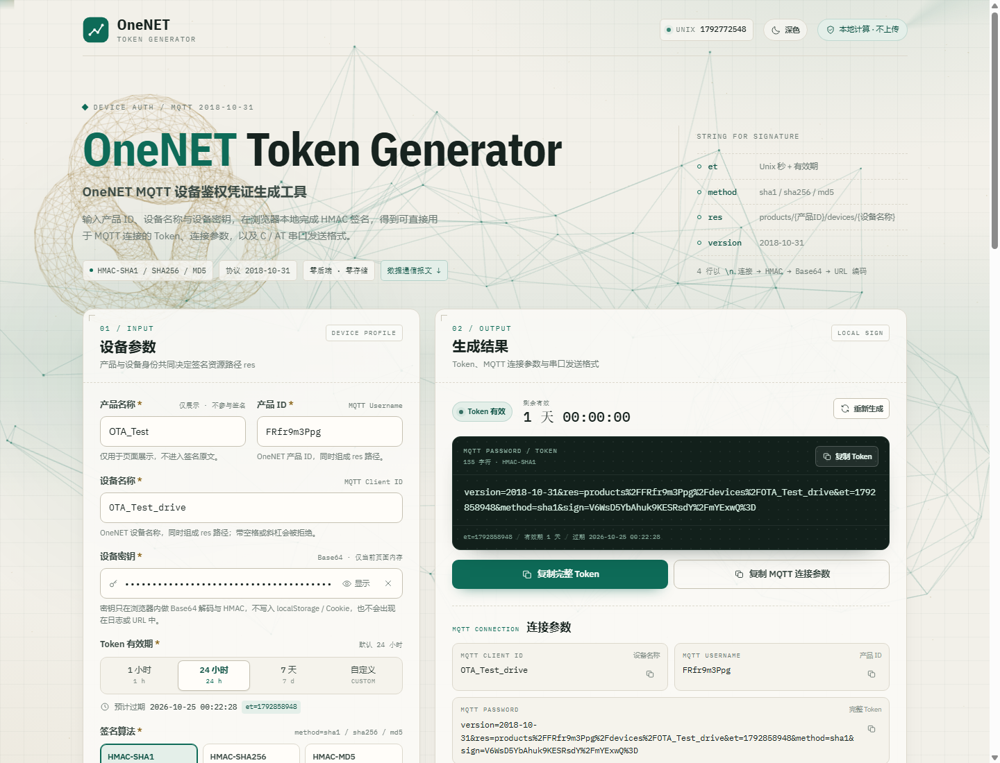
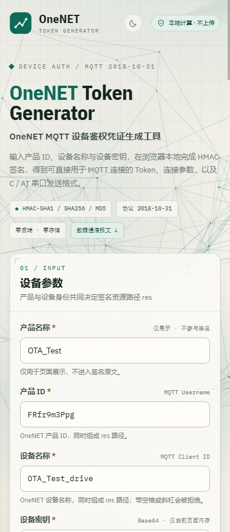
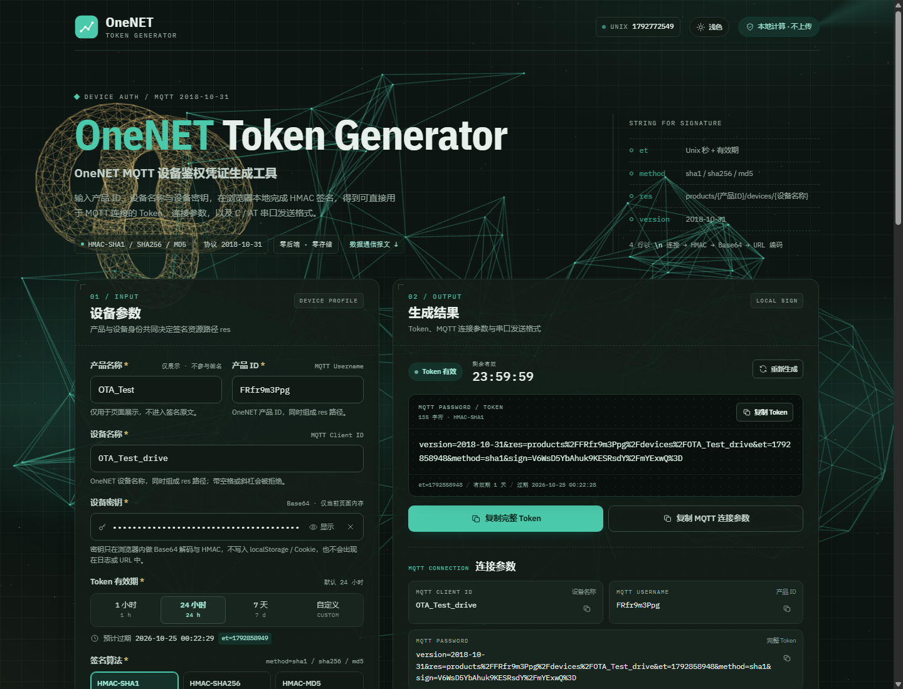
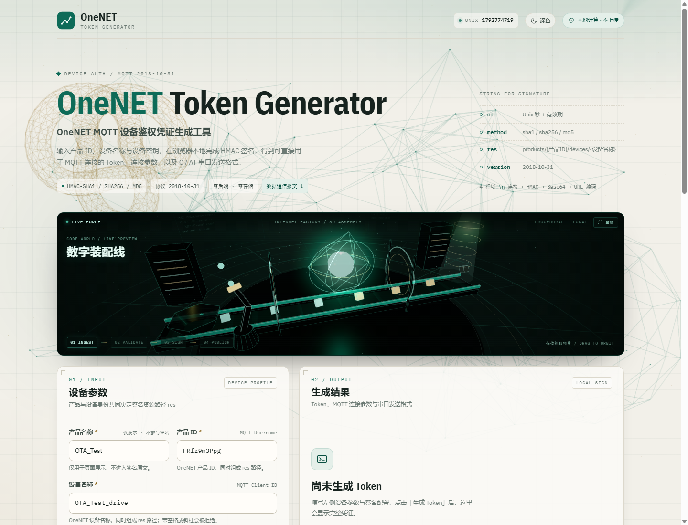
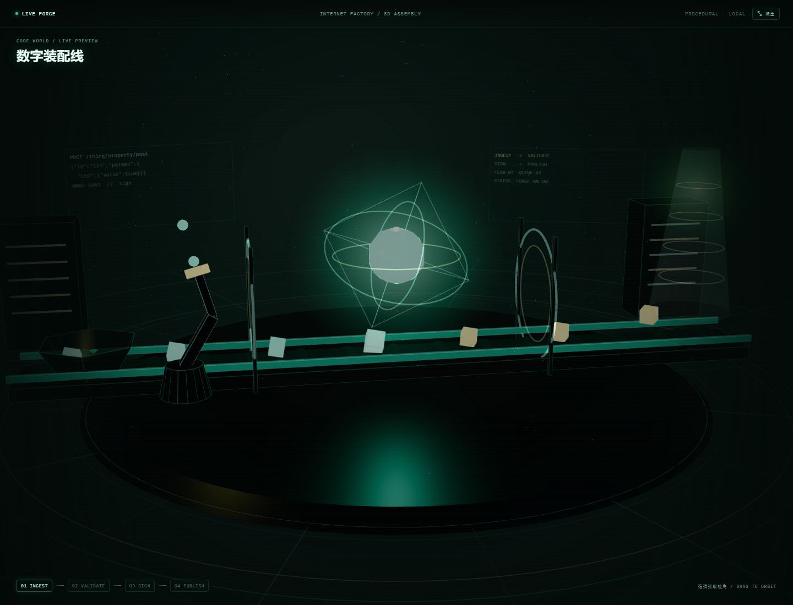
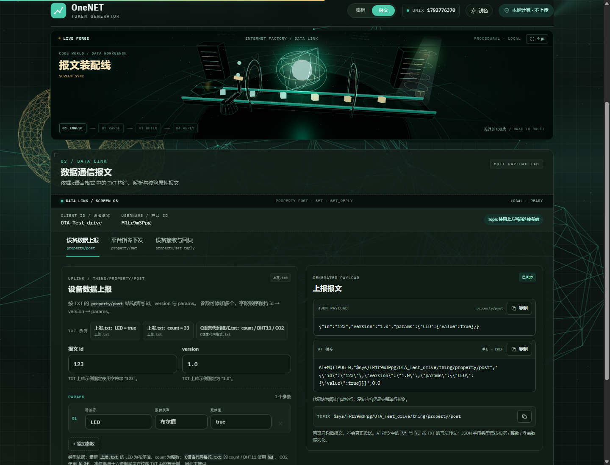
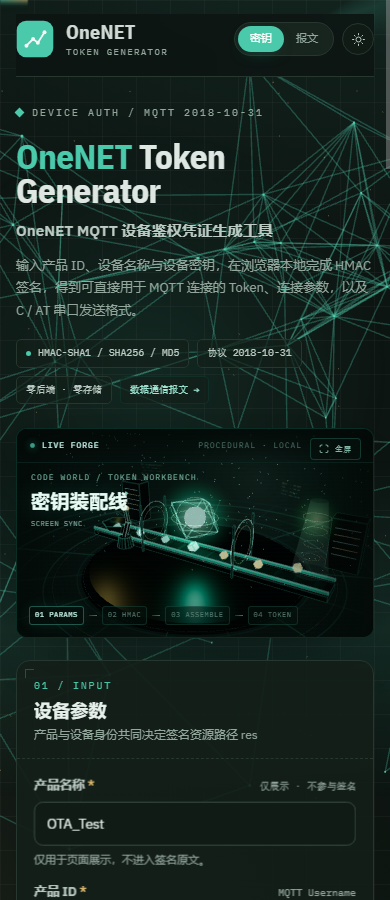
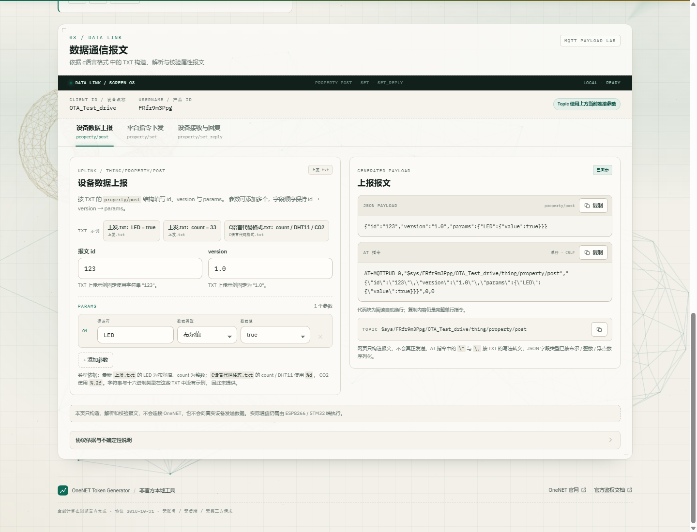
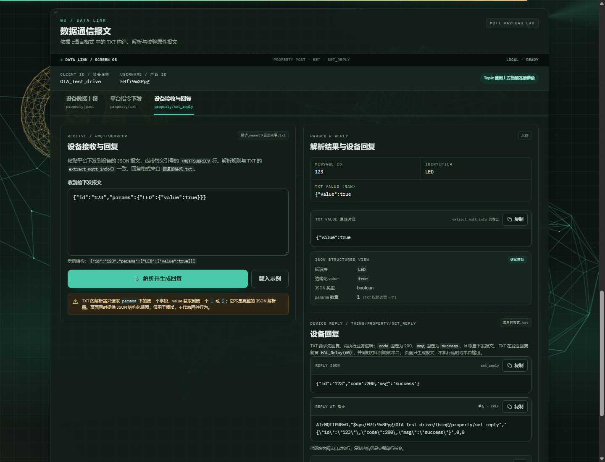
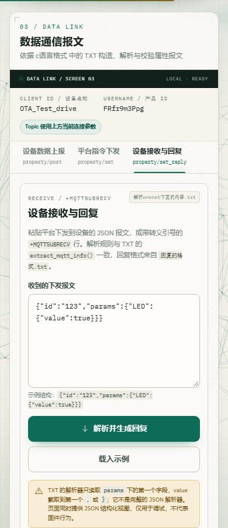

# OneNET Token Generator

OneNET MQTT 设备鉴权凭证生成工具。输入产品 ID、设备名称与设备密钥，在浏览器本地完成 HMAC 签名，生成 MQTT Token、连接参数，以及与 `c语言格式/C语言代码格式.txt` 对齐的 C / AT 串口发送格式。新增按 `c语言格式` 下四个 TXT 构造属性上报、平台下发测试、接收解析与回复报文，支持浅色 / 深色主题和动态科技背景。

- 页面标题：**OneNET Token Generator**
- 副标题：**OneNET MQTT 设备鉴权凭证生成工具**
- 协议版本：`2018-10-31`
- 算法：HMAC-SHA1 / HMAC-SHA256 / HMAC-MD5
- 技术栈：React 19 + TypeScript + Vite 7 + Motion + GSAP + Three.js
- 无后端、无账号、无数据库、无第三方请求、无任何持久化

## 打开网页（最简单）

双击项目根目录的 **`打开网页.bat`**。脚本会自动检查依赖、按需构建、启动本地服务并打开浏览器：

```text
http://127.0.0.1:4173/
```

启动后会保留一个命令行窗口用于运行服务；**关闭该窗口即停止网页服务**。如果服务已经在运行，再次双击只会直接打开浏览器，不会重复启动。

也可以手动启动已构建页面（不会自动打开浏览器）：

```bash
npm start
```

> 不要直接双击 `dist/index.html` 或 `src/main.tsx`。浏览器会拦截 `file://` 下的 ES module / 跨域资源，页面无法正常加载。必须通过上面的本地 HTTP 服务打开。

## 快速开始（开发模式）

环境要求：Node.js 20.19+（已在 Node 24 上验证）、npm。

```bash
npm install
npm run dev
```

打开终端提示的地址（默认 <http://localhost:5173>）。

生产构建与预览：

```bash
npm run build
npm run preview
```

运行单元测试：

```bash
npm test
```

> 本项目安装时使用了 `--ignore-scripts`（见验证环境），esbuild 的平台二进制由 optionalDependencies 提供，不影响构建。正常情况下直接 `npm install` 即可。

## 界面预览

桌面端（1440px，Three.js 动态背景）：



移动端（390px）：



深色主题：



3D 数字装配线（数据包 → 校验门 → 签名核心 → 出料光束，可拖拽抓取视角）：



全屏沉浸模式：



双屏工作台（右上角切换，切屏保留输入 / Token / 报文状态）：




移动端双屏工作台：



数据通信面板（GSAP / LVGL 风格，浅色 / 深色）：





数据通信面板（390px 单列）：



鼠标移入输入面板时的 3D 倾斜 / 浮起：


## 功能

- 设备参数：产品名称（仅展示）、设备名称、产品 ID、设备密钥（密码框，可显示/隐藏）、有效期（1 小时 / 24 小时 / 7 天 / 自定义）、签名算法、固定协议版本。
- 校验：必填、空字符串、名称非法字符、Base64 严格校验、有效期 1 分钟–365 天、自定义值范围。
- 结果：完整 Token（独立可滚动框）、生成/过期时间、实时剩余时长、签名算法、MQTT Client ID / Username / Password、接入点。
- 复制：完整 Token、整套 MQTT 连接参数、单项 Client ID / Username / Password、C 代码、AT 指令、调试信息。
- 旧结果提示：修改设备名称、产品 ID、密钥、算法或有效期后显示「参数已变更」，Token 置灰并提示重新生成。
- 调试：展示 `res`、`et`、`method`、`sign`（Base64 与 URL 编码）、密钥指纹和完整签名原文；不展示密钥明文。
- 串口格式：C 参数片段与 ESP8266 AT 指令，可一键复制。
- 双屏工作台：右上角「密钥 / 报文」切换两个工作界面；两屏始终挂载，只切换显示，切屏后参数、Token、报文标签、原始内容和回复结果都保留；顶部切换栏滚动时保持可见，3D 装配线固定在自己的初始文档位置，不随页面滚动悬浮。
- 交互式 3D 装配线：Three.js 程序化工厂视口，数据包沿传送带经过校验门、签名核心、机械臂和出料光束；每完成一个参数、生成 Token、生成/解析报文或切屏都会触发机械臂、核心与镜头动作；镜头自动巡航，鼠标拖拽可抓取视角，右上角可切换全屏沉浸模式。
- 浮空输入：每个参数区域独立缓慢浮动，悬停/聚焦时暂停浮动并抬起；只作用于显示层，不改变输入值。
- 数据通信：设备数据上报（JSON / AT）、平台指令下发测试报文、设备接收 TXT 规则解析与 set_reply 回复；默认上报与最新 `上发.txt` 的两条 AT 指令逐字符对齐。
- 数据屏：数据通信区采用 LVGL 风格屏幕状态栏与分段标签；首次滚入视口时播放 GSAP 启动时间线，切换标签时内容按方向滑入、卡片错峰出现，指示灯与状态栏有轻微扫描动效；动画结束后清除 transform，保证正文清晰可读。
- 主题与背景：页面每次加载默认进入深色「黑夜」模式，右上角可切换浅色 / 深色；切换时对背景、文字、边框做约 420ms 颜色过渡；Three.js WebGL 场景包含 3D 节点网络、线框二十面体、环面结、粒子尘埃，随鼠标和滚动产生视差，叠加 CSS 扫描线与雷达弧；尊重 `prefers-reduced-motion`。主题不写入任何存储。
- Motion 动画：顶部滚动进度条、Hero 签名结构图滚动视差；均只作用于显示层。
- GSAP 动画：数据通信屏幕启动、标签滑动指示器、标签内容左右滑入、卡片错峰；`prefers-reduced-motion` 下跳过动画并直接显示。
- 3D 交互：鼠标在 Token 输入面板或数据通信输入卡片上移动时，卡片会跟随指针轻微倾斜、浮起并产生光斑；离开后平滑复位。只改变 CSS 视觉，不读取或修改任何表单 / Token 数据；触摸设备和减少动态偏好下自动禁用。
- 响应式：桌面双栏、平板/手机单列；390px 与 320px 下无横向溢出。

## 算法实现

实现位置：`src/lib/onenet.ts`

```text
StringForSignature = et + "\n" + method + "\n" + res + "\n" + version
res    = products/{产品ID}/devices/{设备名称}
et     = floor(Date.now() / 1000) + 有效期秒数
method = sha1 | sha256 | md5

sign  = Base64( HMAC( Base64Decode(设备密钥), StringForSignature ) )
token = version=2018-10-31&res=URL编码(res)&et=et&method=method&sign=URL编码(sign)
```

关键细节：

- 密钥先做严格 Base64 解码，再用解码后的二进制作为 HMAC key。
- `method` 传入 `sha1` / `sha256` / `md5`，不是 `hmacsha1`。
- `et` 是 Unix **秒**级时间戳。
- `res` 与 `sign` 只做一次 RFC 3986 编码：`/` → `%2F`、`+` → `%2B`、`=` → `%3D`。
- 参数顺序固定为 `version`、`res`、`et`、`method`、`sign`。
- HMAC-MD5 使用经过审计、零依赖的 `@noble/hashes` 实现（Web Crypto 不提供 MD5）。

单元测试包含三组本地合成的固定输入/固定输出向量（三种 HMAC）、URL 编码、不同设备/产品/有效期、非法 Base64、密钥不泄漏、过期时间与秒级时间戳等断言。测试密钥为本地合成的 ASCII 字节，不是真实设备密钥。

## 数据通信报文实现

实现位置：`src/lib/dataMessages.ts`。页面区域在 Token 结果下方，三个独立标签页：

- **设备数据上报**：`property/post`
- **平台指令下发**：`property/set` 测试报文
- **设备接收与回复**：TXT 解析结果 + `property/set_reply`

### 协议依据（逐文件整理，未合并）

| TXT 文件 | 识别出的用途 | 页面实现 |
| --- | --- | --- |
| `C语言代码格式.txt` | `property/post` 的 `count / DHT11 / CO2`（`%d`、`%.2f`）；`property/set_reply` 的 `id / code=200 / msg=success`；注释要求先回复、再执行业务逻辑 | C 文件示例；接收后的回复；`HAL_Delay(60)` 说明 |
| `上发.txt`（最新） | 两条可直接发送的 `property/post` AT 指令：`LED=true`、`count=33` | 默认上报 = `LED=true`；示例 = `count=33`；与 TXT 逐字符一致 |
| `解析onenet下发的内容.txt` | `extract_mqtt_info()` 的 `id`、`params` 首个标识符、value 提取规则；`id` 63 字符、标识符 / value 31 字符截断 | 设备接收解析标签 |
| `回复的格式.txt` | `set_reply` 回复结构；`true/1` 与 `false/0` 业务判断 | 设备回复与解析说明 |

### 设备数据上报

最新 `上发.txt` 的两条默认/示例报文（字段顺序与 TXT 一致）：

```json
{"id":"123","version":"1.0","params":{"LED":{"value":true}}}
{"id":"123","version":"1.0","params":{"count":{"value":33}}}
```

- 页面默认值即第一条 `LED=true`，AT 指令与 `上发.txt` 第 1 条除末尾 CRLF 外逐字符一致。
- 第二个示例 `count=33` 对应 `上发.txt` 第 2 条。
- 另保留 `C语言代码格式.txt` 的 `count / DHT11 / CO2` 多参数示例。
- `id`：字符串，默认为 TXT 示例 `123`，可修改。
- `version`：字符串，默认为 TXT 示例 `1.0`。
- `params`：至少一个参数，可添加 / 删除多个；每个参数为 `"标识符": {"value": ...}`。
- 数据类型：
  - 布尔值：JSON `true` / `false`（最新 TXT 的 `LED`）。
  - 整数：按 `%d`，限制 32 位有符号范围（`count`；C 文件的 `DHT11`）。
  - 浮点数：按 `%.2f` 固定两位小数（C 文件的 `CO2`）。
- TXT 未给出字符串 / 十六进制数据类型示例，因此页面不提供这两个选项。
- 生成两种输出：
  - 原始 JSON。
  - `AT+MQTTPUB=0,"$sys/{产品ID}/{设备名称}/thing/property/post","...",0,0`，按 TXT 对 JSON 的 `"` → `\"`、`,` → `\,` 转义，末尾含 CRLF。
- 代码块自动换行仅为页面阅读；复制内容保持完整原始字符串。

### 平台指令下发

TXT 只提供了下发解析规则，没有完整平台下发样例。页面生成解析器所需的最小测试报文，不添加 `version` 等无 TXT 依据的字段：

```json
{"id":"123","params":{"LED":{"value":true}}}
```

- 支持布尔值 `true/false`，以及 TXT 回复逻辑实际匹配的整数 `1/0`。
- 下发 Topic 使用当前连接参数的 `$sys/{产品ID}/{设备名称}/thing/property/set`。
- 可通过「送入接收与回复」把测试报文送入解析页；该操作只在本页传递字符串，不发送网络请求。

### 设备接收解析

解析严格复现 TXT 的 `extract_mqtt_info()`：

1. 从输入的第一个 `{` 开始。
2. 找到 `"id"`，兼容字符串 id 与纯数字 id；缓冲区最多 63 字符。
3. 找到 `"params"` 后的第一个 `{`，只取第一个标识符；标识符最多 31 字符。
4. `value` 从标识符后的 `:` 开始，截取到第一个 `,` 或 `}`；最多 31 字符。

因此对于 OneNET 常见的嵌套结构：

```json
{"id":"123","params":{"LED":{"value":true}}}
```

TXT 解析器得到的 value 原始片段实际是 `{"value":true`（在第一个 `}` 处截断），不是 `true`。固件随后用 `strstr(value, "true")` 判断布尔值。页面同时显示：

- **TXT 原始解析结果**：`id`、标识符、`value` 原始片段（带截断提示）。
- **JSON 结构化视图**：单独用 JSON 解析展示 `value=true` 与类型；明确标注“调试辅助，不代表 TXT 固件行为”。

支持粘贴纯 JSON，或带 `\"` 转义的 `+MQTTSUBRECV` 行（页面会提示“AT URC 转义已还原”）。

### 设备回复

TXT 规定先回复、再执行业务逻辑；回复 Topic 为 `$sys/{产品ID}/{设备名称}/thing/property/set_reply`，id 取自下发报文：

```json
{"id":"123","code":200,"msg":"success"}
```

- `code` 固定 `200`，`msg` 固定 `"success"`（TXT 只定义了这一组成功值）。
- 同时生成对应 AT 指令，并按 TXT 原样转义引号 / 逗号。
- TXT 在发送回复前有 `HAL_Delay(60)` 并同时打印调试串口；页面只构造报文，不执行延时或串口输出。

### 数据通信边界

- 页面只构造、解析和校验报文，不会连接 OneNET、不会向真实设备发送数据。
- 当前产品 ID / 设备名称取自上方 Token 表单；为空时 Topic 使用 `YOUR_PRODUCT_ID / YOUR_DEVICE_NAME` 占位符。
- 浮点格式、字段顺序、大小写、转义方式均按 TXT；AT 转义未在真实 ESP-AT 上逐字节回放。
- TXT 未定义字符串 / 十六进制类型、失败 code、其他 msg，页面不自行编造。

### 主题切换

右上角按钮切换浅色 / 深色。切换时给根元素加 `theme-animating` 类，对颜色、背景、边框做约 420ms 过渡；`prefers-reduced-motion` 下自动缩短。主题状态只保存在当前页面内存，不写入 localStorage / sessionStorage / Cookie，刷新后回到浅色。

## 密钥安全设计

- 密钥读取、Base64 解码、HMAC 计算全部在浏览器内完成。
- 不使用 `localStorage`、`sessionStorage`、Cookie、IndexedDB。
- 不向任何服务器发送密钥或 Token；生产构建注入 CSP，只允许加载同源资源。
- 不写控制台日志，不把密钥放进 URL；密码框默认关闭自动补全提示。
- 密钥输入使用非受控输入框，密钥不会写进可被序列化的 DOM `value` 属性。
- 刷新/关闭页面不恢复密钥；切换到其他标签页时自动清空密钥输入；重置表单时清空密钥与结果。
- 调试区只显示密钥的 SHA-256 指纹（前 12 位）与解码后字节数，不显示明文。

> 请勿在公共电脑或不可信网页中输入真实设备密钥。Token 等同于 MQTT 密码，生成后请妥善保管。

## 目录结构

```text
.
├─ 打开网页.bat           # 双击：启动服务并打开浏览器
├─ index.html
├─ vite.config.ts          # Vite + 生产环境 CSP 注入 + Vitest 配置
├─ tsconfig.json
├─ package.json
├─ public/favicon.svg
├─ scripts
│  └─ serve-dist.mjs      # 零依赖静态服务器（服务 dist/）
├─ docs
│  ├─ preview-three-light.png
│  ├─ preview-three-dark.png
│  ├─ preview-three-mobile.png
│  ├─ preview-forge.png
│  ├─ preview-forge-mobile.png
│  ├─ preview-forge-fullscreen.png
│  ├─ preview-workbench-token.png
│  ├─ preview-workbench-data.png
│  ├─ preview-workbench-mobile.png
│  ├─ preview-data.png
│  ├─ preview-data-dark.png
│  ├─ preview-data-mobile.png
│  └─ preview-tilt-form.png
├─ src
│  ├─ main.tsx
│  ├─ App.tsx              # 双屏状态、复制、自动清除、旧结果判断、主题与视图
│  ├─ styles.css           # 设计系统、响应式布局、深色主题
│  ├─ styles-data.css      # LVGL 风格数据屏 / 状态栏 / 滑动标签
│  ├─ styles-tech.css      # 动态科技背景 / 扫描线 / 光晕 / 3D 倾斜
│  ├─ styles-forge.css     # 3D 装配线 / HUD / 抓取准星
│  ├─ styles-workbench.css # 双屏切换 / 粘性工作台 / 浮空输入
│  ├─ model.ts             # 表单模型、有效期换算、前端校验
│  ├─ model.test.ts
│  ├─ components
│  │  ├─ DeviceForm.tsx
│  │  ├─ ResultPanel.tsx
│  │  ├─ SecurityNote.tsx
│  │  ├─ Header.tsx        # 品牌栏 + 视图切换 + 主题切换
│  │  ├─ TechBackground.tsx # Three.js 3D 网络 / 线框核心 / 粒子
│  │  ├─ DataForge.tsx     # Three.js 数字装配线 / 拖拽抓取 / 参数响应
│  │  ├─ ScrollProgress.tsx # Motion 顶部滚动进度
│  │  ├─ CardTilt.tsx      # 输入卡片鼠标 3D 倾斜（纯显示）
│  │  ├─ Toast.tsx
│  │  ├─ Icons.tsx
│  │  ├─ DataCommPanel.tsx # GSAP 数据屏 / 三个标签页
│  │  ├─ UploadBuilder.tsx # 设备数据上报（默认 LED=true）
│  │  ├─ DownlinkBuilder.tsx # 平台指令下发测试
│  │  ├─ ReceiveReply.tsx  # TXT 解析 + set_reply
│  │  └─ CommUi.tsx        # 报文复制 / 代码块 / 校验提示
│  └─ lib
│     ├─ onenet.ts         # ★ Token 算法、URL 编码、输入校验
│     ├─ base64.ts         # 严格 Base64 解码
│     ├─ serial.ts         # MQTT 参数 / C / AT 文本生成
│     ├─ format.ts         # 时间与倒计时格式化
│     ├─ dataMessages.ts   # ★ 属性上报 / 下发 / 回复协议
│     ├─ forgeBus.ts       # 显示层机器动作事件（不影响业务）
│     ├─ onenet.test.ts
│     ├─ serial.test.ts
│     ├─ format.test.ts
│     └─ dataMessages.test.ts
└─ c语言格式/              # 原有 TXT 资料（未修改）
```

## 验证结果

- `npx tsc --noEmit`：通过。
- `npm test`：5 个测试文件、**64 项测试**全部通过（原 39 项 Token / 表单 / 串口测试 + 新增 25 项协议测试）。
- `npm run build`：通过，492 个模块；JS 1,099.79 kB（gzip 320.40 kB），CSS 63.37 kB（gzip 12.16 kB）。
- 无头 Chrome 真实交互验证：
  - 原有 Token：默认设备参数下生成 SHA1 Token，签名与独立 Node HMAC 完全一致；Client ID / Username / Password 与生成结果一致。
  - 双屏：右上角切换后，密钥屏 / 报文屏 hidden、inert 状态正确；密钥、参数、Token、报文标签、原始报文和回复结果在多次切屏后保持；切屏不刷新页面。
  - 机器响应：参数完成显示 `PARAM LOCKED`，生成 Token 显示 `TOKEN FORGED`，报文动作显示 `MESSAGE ASSEMBLED`，切屏显示 `SCREEN SYNC`；3D 画布持续运行。
  - 3D 位置：初始 `position: relative/top: auto`；页面滚动 760px 后装配线顶部约为 `-315px`，随页面滚走而不悬浮遮挡；顶部切换栏 `top=0`，视图切换按钮仍可见。
  - 初始主题：`html[data-theme='dark']`，页面加载即为深色，主题按钮显示“浅色”。
  - 浮空输入：`.form-panel .field` 应用 `field-float` 动画；聚焦/悬停时停止浮动并抬起。
  - 数据上报：默认 `LED=true` 与 `上发.txt` 第 1 条、`count=33` 与第 2 条逐字符一致（仅末尾 CRLF）；C 文件 `CO2` 两位小数；AT 引号 / 逗号转义、复制、缺少 id 的校验提示。
  - 下发与回复：生成 `id + params` 测试报文、送入接收页、TXT 原始 value 片段、结构化 value、`set_reply` JSON / AT、复制、缺少 id 的错误提示、URC 转义解析。
  - Three.js：WebGL 2 上下文创建成功，背景和装配线共 2 个 WebGL 上下文；相隔 900ms 的截图不同；鼠标按下进入 `is-grabbing`、光标变为 `grabbing`、准星显示，松开复位；全屏后画布同步为 1440×1100。
  - Motion：滚动进度条数值变化；Hero 结构图视差挂载。
  - GSAP：数据屏初始 opacity 0，滚入后启动到 1；标签指示器从“设备数据上报”滑到“平台指令下发”；切换瞬间存在位移/透明度，结束后卡片 opacity ≥ 99.5% 且无残留 transform；减少动态偏好下直接显示。
  - 主题与背景：初始深色、浅色 / 深色切换、过渡类添加与清理、切换后 Token 结果保留。
  - 布局：390px 无横向溢出，3D 工作台高度 210px，视图切换按钮可见。
  - 控制台 0 错误、0 页面异常、0 失败请求、0 外部网络请求；无 localStorage / sessionStorage / Cookie。
- 原有 Token 核心文件哈希保持不变：`src/lib/onenet.ts`、`src/lib/serial.ts`、`src/model.ts`、`src/components/ResultPanel.tsx`、`src/components/DeviceForm.tsx`。
- 未与真实 OneNET 设备做在线连接测试；本次新增功能也不连接 OneNET 或真实设备。

## 已知边界

- Token 有效期基于本机时钟计算；本机时间偏差会导致云端鉴权失败。
- 仅支持 OneNET 控制台提供的标准 Base64 设备密钥（含 `=` 填充）；不支持 Base64URL 变体。
- 设备/产品名称会拒绝空白、斜杠、引号和控制字符，以保证 `res` 与 AT 指令安全。
- 浏览器端签名只证明凭证格式与算法正确；设备能否上线仍取决于产品/设备是否已在 OneNET 创建、密钥是否匹配以及网络环境。
- 数据通信部分只构造 / 解析 / 校验报文，不真正发送或接收；实际通信仍由 ESP8266 / STM32 端完成。
- TXT 没有完整平台下发样例；“平台指令下发”只生成解析器所需的 `id + params` 最小结构，未添加 `version` 等无依据字段。
- TXT 没有字符串 / 十六进制类型示例，页面未提供；TXT 回复只定义 `code=200`、`msg=success`，未扩展失败 code。
- TXT 的 `extract_mqtt_info()` 不是完整 JSON 解析器，只取 `params` 第一个字段并把 value 截到第一个 `,` / `}`；页面的结构化 value 视图仅作调试辅助。
- AT 指令的引号 / 逗号转义按 TXT 原样复现，尚未在真实 ESP-AT 模块上逐字节回放验证。
- 最新 `上发.txt` 两行本身不带 CRLF；页面生成的 AT 指令末尾带 CRLF（TXT 的 C 代码发送时也带 `\r\n`）。页面提供“单行 · CRLF”提示，复制为完整单行。
- 深色 / 浅色主题仅保存在当前页面内存；每次重新加载默认深色，主题按钮不会写入存储。
- 动态背景为 Three.js WebGL 场景 + CSS 扫描线 / 雷达弧，不参与业务计算；WebGL 不可用时保留 CSS 背景；`prefers-reduced-motion: reduce` 下停止 3D 动画并隐藏扫描线。
- 3D 倾斜仅作用于 `.form-panel` / `.comm-input-card` 的 CSS transform 和光斑，不读取、不修改任何密钥、Token 或报文状态；触摸设备与 `prefers-reduced-motion` 下禁用。
- Three.js 使主包增长到约 320 kB gzip；这是为了 3D 背景、装配线、粒子和 GSAP 数据屏的体积成本，页面仍为纯本地静态资源。
- 3D 装配线使用第二个 WebGL 上下文；页面隐藏或视口外时暂停渲染。拖拽抓取仅支持鼠标；触摸设备自动巡航，避免抢占纵向滚动。全屏依赖浏览器 Fullscreen API。
- 3D 装配线在 `prefers-reduced-motion` 下只渲染静态帧，不自动巡航，也不启用抓取拖拽。
- GSAP 数据屏动画只在首次滚入和标签切换时运行，结束会清理内联 transform；`prefers-reduced-motion` 下不隐藏、不滑动，直接展示数据。
- 双屏始终同时挂载，只通过 hidden / inert 切换显示；切屏保留当前页面内的输入、Token 和报文状态，刷新页面后仍会重置。
- 参数完成反馈基于输入框失焦且值非空（或点击有效期/算法选项），不改变原有校验规则；机器动作只读取显示层事件。
- 顶部切换栏是粘性的，滚动时保持可见；3D 工作台不粘性，停留在初始文档位置，随页面滚走，避免遮挡输入区域。移动端隐藏本地徽标为切换按钮让位。
